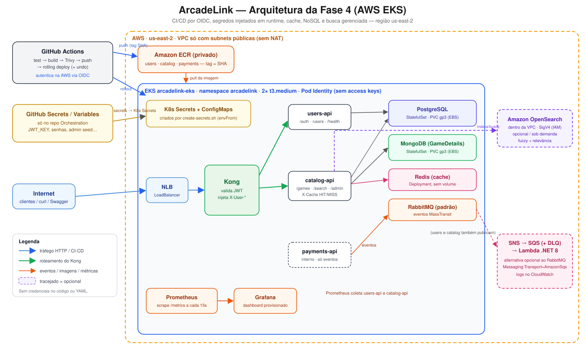

# ArcadeLink.Orchestration

Guia central da **Fase 4** do Tech Challenge NETT: infraestrutura como código (Terraform), manifestos
Kubernetes da plataforma, scripts de operação e o workflow que injeta os segredos no cluster. Os três
microsserviços (`ArcadeLink.Users`, `ArcadeLink.Catalog`, `ArcadeLink.Payments`) têm seus próprios
manifestos e pipelines; este repositório cuida de tudo que é compartilhado: EKS, ECR, OpenSearch, Postgres,
MongoDB, Redis, RabbitMQ, Kong, Prometheus e Grafana.



## Requisito do enunciado → onde está

| Requisito (PDF da Fase 4) | Onde está |
|---|---|
| **1. Infra gerenciada** — K8s gerenciado | EKS `arcadelink-eks` (`terraform/env/eks.tf`, `vpc.tf`), 2× `t3.medium` |
| 1. Registry privado | Amazon ECR `arcadelink/{users,catalog,payments}` (`terraform/bootstrap/main.tf`) |
| 1. Load Balancer / Ingress | `k8s/kong/service.yaml` — Service `LoadBalancer` (NLB) na frente do Kong; o resto é `ClusterIP` |
| **2. NoSQL** (MongoDB + driver oficial) | `k8s/mongodb/statefulset.yaml` (PVC gp3); `GameDetails` no Catalog (`MongoDB.Driver`) |
| 2. Cache distribuído | `k8s/redis/`; `StackExchange.Redis` em Users, Catalog (`X-Cache: HIT/MISS/BYPASS`) e Payments |
| **3. Busca** (OpenSearch) | `terraform/env/opensearch.tf` (domínio `arcadelink-search`, na VPC); indexação e `GET /search` no Catalog (fuzzy `AUTO`, boosts título×3/tags×2/gênero×2, ordenação por relevância); `POST /admin/search/reindex` |
| **4. CI/CD** — build & test | `.github/workflows/ci-cd.yml` de cada serviço (`dotnet test`) |
| 4. Imagem com tag | `docker build` com tag = SHA do commit; `APP_VERSION` (SHA curto) aparece em `GET /health` |
| 4. Security scan | Trivy (CRITICAL, `ignore-unfixed`) antes do push |
| 4. Push para o registry | `docker push` para o ECR, autenticado por OIDC |
| 4. Deploy sem downtime | `kubectl apply` + rolling update (`maxUnavailable: 0`, `maxSurge: 1`, startup/readiness/liveness em `/health`) e `rollout undo` se o rollout falhar |
| **5. Zero hardcoded credentials** | GitHub Secrets (só neste repo) → `scripts/create-secrets.sh` → K8s Secrets (`envFrom`); `dotnet user-secrets` e `.env` em dev; nenhum `secret.yaml` versionado |
| Entregáveis | Código e pipelines nos repositórios; IaC em `terraform/`; relatório e roteiro do vídeo em `Temp/` do workspace |

## Pré-requisitos

- Conta AWS com créditos/plano pago (o EKS não entra no free tier) e uma IAM identity capaz de criar os recursos.
- Ferramentas: `terraform` (>= 1.x, ver `versions.tf`), `aws` CLI v2, `kubectl`, `gh` (autenticado),
  `envsubst` (pacote `gettext`), `openssl`, `jq` e `curl` (demos).
- Os 4 repositórios no GitHub (`Users`, `Catalog`, `Payments`, `Orchestration`) com branch `main`.

## Ordem completa de execução

1. **Bootstrap (uma vez)** — `terraform/bootstrap/`: bucket S3 do state, 3 repositórios ECR, provider OIDC do
   GitHub + role `arcadelink-github-actions`, Budget e a service-linked role do OpenSearch.
   ```bash
   cd terraform/bootstrap
   cp terraform.tfvars.example terraform.tfvars   # github_owner, budget_email, budget_limit_usd...
   terraform init && terraform apply
   terraform output                               # state_bucket_name, ecr_registry, github_actions_role_arn
   ```
2. **GitHub Secrets e Variables** — veja a seção "Segredos" abaixo (Variables nos 4 repos; Secrets só aqui).
3. **Subir o ambiente** (EKS + add-ons; ~15-20 min):
   ```bash
   GITHUB_OWNER=<seu-usuario> scripts/up.sh                    # sem OpenSearch
   GITHUB_OWNER=<seu-usuario> ENABLE_OPENSEARCH=true scripts/up.sh   # com OpenSearch (~15 min a mais)
   ```
   O `up.sh` roda `terraform apply` em `terraform/env/`, atualiza o kubeconfig, cria o namespace e dispara
   `deploy-platform.yml` (Orchestration) e `ci-cd.yml` (Users, Catalog, Payments).
4. **Workflows**: `deploy-platform` cria os Secrets/ConfigMap e aplica Postgres, MongoDB, Redis, Prometheus,
   Grafana, Kong e RabbitMQ; cada `ci-cd.yml` faz test → build → Trivy → push → deploy da sua API. Conferir:
   ```bash
   kubectl get pods,svc,pvc -n arcadelink
   kubectl get svc kong -n arcadelink -o jsonpath='{.status.loadBalancer.ingress[0].hostname}'
   ```
5. **Usar/demonstrar**: `curl http://<nlb>/health/users`, `/health/catalog`, `/games`, `/search?q=...`;
   `scripts/demo-search.sh` e `scripts/demo-cache.sh` (ver abaixo).
6. **Destruir quando ocioso**: `scripts/teardown.sh`.

### Antes do primeiro `apply`

- Confirme que `cluster_version` (`terraform/env/variables.tf`) está em **standard support** — extended
  support custa 6x mais: `aws eks describe-cluster-versions --region us-east-2`. Ajuste em `terraform.tfvars`.
- Confirme `opensearch_engine_version`: `aws opensearch list-versions --region us-east-2`.
- Copie `terraform/env/terraform.tfvars.example` para `terraform.tfvars` e preencha `github_actions_role_arn`
  (output do bootstrap).

### Notas do bootstrap

- O bootstrap usa **state local**: guarde `terraform/bootstrap/terraform.tfstate` (está no `.gitignore`; faça
  backup fora do repositório). Perdê-lo obriga a importar os recursos manualmente.
- `aws_iam_openid_connect_provider` falha com `EntityAlreadyExists` se a conta **já tem** o provider OIDC do
  GitHub: importe-o (`terraform import aws_iam_openid_connect_provider.github arn:aws:iam::<conta>:oidc-provider/token.actions.githubusercontent.com`).
- Se a service-linked role do OpenSearch já existe na conta, use `create_opensearch_slr = false`.
- O Budget usa `include_credit = false` (alerta pelo custo bruto, mesmo com créditos).

## Custo e a regra "destruir quando ocioso"

Referência us-east-2: control plane EKS ~US$ 0,10/h; 2× `t3.medium` ~US$ 0,084/h; NLB ~US$ 0,0225/h + LCU;
IPv4 público ~US$ 0,005/h por IP (2 nós + IPs do NLB, ~US$ 0,02/h no total);
`t3.small.search` ~US$ 0,036/h; EBS gp3 US$ 0,08/GB-mês. Ambiente completo sem OpenSearch ~US$ 0,23/h; com
OpenSearch ~US$ 0,27/h; deixado ligado um mês inteiro, ~US$ 170. **Rode `scripts/teardown.sh` sempre que
terminar de trabalhar.** Ele remove o namespace (liberando NLB e volumes EBS criados pelo Kubernetes), espera
sumirem, executa `terraform destroy` e avisa se sobrou algo (inclusive roles IAM `arcadelink-*`). O bootstrap
(S3, ECR, OIDC, Budget) fica de pé e custa centavos por mês.

## OpenSearch sob demanda

Desligado por padrão (`enable_opensearch=false`): o Catalog sobe, o CRUD funciona, POST/PUT/DELETE não
falham e `GET /search` responde **503** (ProblemDetails) — nunca 500 e nunca resultado vindo do Postgres.
Para ligar (domínio leva ~15 min; ligue ~40 min antes de gravar):

```bash
GITHUB_OWNER=<owner> ENABLE_OPENSEARCH=true scripts/up.sh
# ou, com o cluster já de pé:
terraform -chdir=terraform/env apply -var enable_opensearch=true
gh workflow run deploy-platform.yml -R <owner>/ArcadeLink.Orchestration   # recria Secret com Search__Endpoint e reinicia (create-secrets.sh --restart)
```

Jogos criados enquanto a busca estava desligada **só ficam pesquisáveis depois do reindex**:
`POST /admin/search/reindex` (token de Admin). O `scripts/demo-search.sh` já faz seed + reindex + buscas com
erro de digitação.

```bash
scripts/demo-search.sh <host-do-nlb> <admin-email> <admin-senha>   # ex.: "zeldda", "holow nite"
scripts/demo-cache.sh  <host-do-nlb> [n=50] [admin-email admin-senha]  # MISS na 1ª chamada, HITs depois
```

Regras do `/search`: `q` de 2 a 100 caracteres, `page` 1-100, `size` 1-50; entrada inválida -> 400 com
mensagem; OpenSearch indisponível -> 503.

## Segredos

Nada sensível vive no código nem nos YAML. Os valores são gerados por você e guardados **apenas** como
GitHub Secrets deste repositório; o workflow `deploy-platform` (ou `scripts/create-secrets.sh` manualmente)
os transforma em Secrets do Kubernetes. Gere com `openssl rand -hex 24` (senhas — só `[0-9a-f]`) e
`openssl rand -hex 32` (`JWT_KEY`).

| GitHub Secret | K8s Secret / chave de destino |
|---|---|
| `JWT_KEY` | `users-api-secret` (`Jwt__Key`) e `kong-declarative-config` (`kong.yml` renderizado) |
| `POSTGRES_PASSWORD` | `postgres-secret`; `ConnectionStrings__Postgres` em `users-api-secret` e `catalog-api-secret` |
| `MONGO_ROOT_PASSWORD` | `mongodb-secret`; `Mongo__ConnectionString` em `catalog-api-secret` |
| `REDIS_PASSWORD` | `redis-secret`; `Redis__ConnectionString` nos 3 `*-api-secret` |
| `RABBITMQ_PASSWORD` | `rabbitmq-secret`; `RabbitMq__Password` nos 3 `*-api-secret` |
| `GRAFANA_ADMIN_PASSWORD` | `grafana-secret` (`GF_SECURITY_ADMIN_PASSWORD`) |
| `ADMIN_SEED_EMAIL`, `ADMIN_SEED_PASSWORD` | `users-api-secret` (`AdminSeed__*`) — cria o admin no primeiro start |

`search` não tem Secret próprio: `Search__Endpoint` (descoberto no domínio `arcadelink-search`) vai em
`catalog-api-secret`, e o acesso é por IAM/SigV4 via **EKS Pod Identity** — sem access keys.

**Variables** (não sensíveis), em **cada um dos 4 repositórios**: `AWS_REGION` (`us-east-2`), `AWS_ROLE_ARN`
(output `github_actions_role_arn`), `EKS_CLUSTER_NAME` (`arcadelink-eks`), `ECR_REGISTRY` (output
`ecr_registry`). Opcional, só no Orchestration: `MESSAGING_TRANSPORT` (`RabbitMq` padrão ou `AmazonSqs`).

### JWT do Kong

O Kong valida o JWT com a mesma chave do Users (`Jwt__Key`). Não há chave no repositório: `k8s/kong/kong.yml.tpl`
é um template com `${JWT_KEY}`, e o `create-secrets.sh` renderiza `kong.yml` com `envsubst` a partir do
mesmo GitHub Secret `JWT_KEY`, gravando-o no Secret `kong-declarative-config`. Se a chave mudar, rode o
`deploy-platform` de novo (ele reinicia Kong e APIs) — senão o Kong rejeita os tokens com 401.

### Histórico do Git

O histórico dos repositórios ainda contém placeholders de desenvolvimento de fases anteriores (`postgres`,
`guest`, uma chave JWT de dev). **Nenhum é usado em produção**: todos os valores de produção são gerados do
zero e só existem nos GitHub Secrets/K8s Secrets. O repositório legado `ArcadeLink.Notifications` (Fase 2,
fora de qualquer deploy) mantém defaults `guest` de RabbitMQ em dev.

## Componentes da plataforma (`k8s/`)

| Componente | Service | Tipo | Observações |
|---|---|---|---|
| Kong | `kong` (80 -> targetPort 8000) | `LoadBalancer` (NLB) | Única exposição externa; modo DB-less; Admin API só em `127.0.0.1` do Pod |
| PostgreSQL | `postgres` (5432) | StatefulSet + PVC gp3 | Bancos `arcadelink_users` e `arcadelink_catalog` (script de init) |
| MongoDB | `mongodb` (27017) | StatefulSet + PVC gp3 | Só o Catalog usa; auth ligada |
| Redis | `redis` (6379) | Deployment | Com senha; sem volume |
| RabbitMQ | `rabbitmq` (5672) | Deployment | Transporte padrão; removido se `AmazonSqs` |
| Prometheus / Grafana | `prometheus` (9090) / `grafana` (3000) | Deployment | Datasource e dashboard provisionados por ConfigMap; Prometheus coleta `users-api` e `catalog-api` a cada 15s |

### Kong: rotas

Valida o JWT do Users e injeta `X-User-Id`/`X-User-Role` (um plugin global remove esses headers se vierem do
cliente). Payments não é exposto.

| Rota | Método(s) | Path | Protegida? |
|---|---|---|---|
| `users-public-auth` | POST | `/auth` | Não |
| `users-protected` | GET, DELETE | `/users` | Sim |
| `catalog-public-reads` | GET | `/games` | Não |
| `catalog-protected` | POST, PUT, DELETE | `/games` | Sim |
| `catalog-search` | GET | `/search` | Não |
| `catalog-admin` | POST | `/admin` (reindex) | Sim (o Catalog exige role Admin) |
| `catalog-library` | GET | `/library` | Sim |
| `users-health` / `catalog-health` | GET | `/health/users`, `/health/catalog` | Não |

### Persistência poliglota e cache

**MongoDB** guarda o `GameDetails` (descrição rica, tags, screenshots) do Catalog — dados flexíveis, sem schema
fixo, fora do Postgres transacional. **Redis**: Users cacheia o lookup de login, Catalog faz cache-aside de
`GET /games`/`GET /games/{id}` (TTL 60s; `X-Cache: HIT|MISS|BYPASS` — `BYPASS` quando o Redis está fora, e a
resposta vem do Postgres), Payments cacheia `Payments:ApprovalRate` (TTL 30s). Detalhes nos READMEs dos serviços.

## Mensageria opcional: SNS/SQS + Lambda

Caminho **obrigatório**: RabbitMQ no cluster e sem serviço de notificação em produção (os eventos
`UserCreated`/`PaymentProcessed` ficam sem assinante de notificação; Catalog e Payments seguem consumindo).
Caminho **opcional**: eventos por SNS -> SQS -> Lambda (repo `ArcadeLink.NotificationsFunction`).

Para ligar:

1. No Orchestration, defina a Variable `MESSAGING_TRANSPORT=AmazonSqs`.
2. `terraform -chdir=terraform/env apply -var enable_messaging=true` (tópicos SNS + políticas das roles de pod).
3. No `ArcadeLink.NotificationsFunction`: `dotnet publish src/ArcadeLink.NotificationsLambda -c Release -r linux-x64 --self-contained false -o terraform/publish`
   e depois `terraform apply` em `terraform/` (SQS + DLQ, assinaturas SNS com raw delivery, Lambda).
4. Rode o `deploy-platform` (cria o ConfigMap `messaging-config`, reinicia as APIs e **remove o RabbitMQ** do cluster).

Para voltar: `MESSAGING_TRANSPORT=RabbitMq` e rode o `deploy-platform` (reaplica o RabbitMQ e reinicia as APIs);
opcionalmente destrua a stack da Lambda e use `enable_messaging=false`.

Atenção: o `teardown.sh` destrói o `env`, o que apaga os tópicos SNS. Depois do próximo `up` com
`enable_messaging=true`, reaplique a stack da Lambda (`terraform apply` em `terraform/` do
`ArcadeLink.NotificationsFunction`) para recriar as assinaturas.

## Troubleshooting

- **Pod `Pending`**: 2 nós `t3.medium` são justos; `kubectl describe pod` mostra `Insufficient cpu/memory`.
  Confira se não há réplicas/rollouts duplicados; no pior caso, derrube Prometheus/Grafana temporariamente.
- **`ImagePullBackOff`**: o `ci-cd` do serviço ainda não publicou a imagem no ECR (rode o workflow) ou a tag/ECR
  está errada (`kubectl describe pod`; `aws ecr list-images --repository-name arcadelink/users`).
- **NLB demorando**: leva 2-5 min até o DNS resolver e o health check passar; use `kubectl get svc kong -n arcadelink -w`.
- **OpenSearch leva ~15 min** para ficar ativo; até lá `/search` devolve 503. Depois de ativo, rode o
  `deploy-platform` (novo `Search__Endpoint`) e o reindex.
- **Postgres não troca a senha depois do primeiro init**: o `POSTGRES_PASSWORD` só vale na criação do volume.
  Para rotacionar, use `ALTER USER postgres PASSWORD '...'` ou apague o PVC (perde os dados).
- **Kong responde 401 a tudo**: `JWT_KEY` diferente entre Users e Kong — rode o `deploy-platform` de novo.
- **`terraform destroy` trava na VPC**: sobrou NLB ou volume EBS criado pelo Kubernetes; o `teardown.sh` evita
  isso — se rodou `destroy` à mão, apague-os (console EC2) e repita.
- **Pods dependentes reiniciam no início**: `Database.Migrate()` falha enquanto o Postgres sobe; autocorrige.

## Ações pendentes do usuário

Nada abaixo foi executado na sessão que implementou o código (exigem conta AWS/GitHub e geram custo):

- [ ] **Task 0 (ferramentas)**: instalar `terraform`, `aws` CLI e `gh`; confirmar que a conta AWS está no plano
      pago (Paid plan) com créditos; `aws configure`/SSO e `gh auth login`.
- [ ] `terraform apply` do `terraform/bootstrap/` (guardar o `terraform.tfstate`); anotar os outputs.
- [ ] Conferir `cluster_version` e `opensearch_engine_version` (comandos acima); `terraform apply` do `terraform/env/` (via `up.sh`).
- [ ] **GitHub Secrets** (Orchestration): `JWT_KEY`, `POSTGRES_PASSWORD`, `MONGO_ROOT_PASSWORD`, `REDIS_PASSWORD`,
      `RABBITMQ_PASSWORD`, `GRAFANA_ADMIN_PASSWORD`, `ADMIN_SEED_EMAIL`, `ADMIN_SEED_PASSWORD`.
- [ ] **GitHub Variables** (os 4 repos): `AWS_REGION`, `AWS_ROLE_ARN`, `EKS_CLUSTER_NAME`, `ECR_REGISTRY`;
      opcional `MESSAGING_TRANSPORT` (Orchestration).
- [ ] **Checkpoint A**: manifestos e deploy manual/pipeline dos 3 serviços no EKS. **B**: segredos e pipelines
      ponta a ponta (live deploy, rollback). **C**: OpenSearch ligado, `demo-search.sh`/`demo-cache.sh`.
      **D (opcional)**: transporte SQS + Lambda.
- [ ] Merge `fase-4 -> main` em cada repo (o deploy automático só dispara em push na `main`).
- [ ] Gravar o vídeo (roteiro em `Temp/ROTEIRO_VIDEO.md`), preencher o relatório (`Temp/RELATORIO_ENTREGA.md`),
      rodar `scripts/teardown.sh` e conferir o Budget.

## Pendências conhecidas (aceitas para o escopo do desafio)

- Sem `NetworkPolicy`: um Pod do namespace ainda pode falar direto com `users-api`/`catalog-api`, contornando o Kong.
- Estado do Terraform do bootstrap é local; o bucket de state não nega acesso sem TLS.
- `deploy-platform` com `--restart` reinicia todos os workloads (inclusive Postgres/MongoDB) a cada push em `k8s/**`.
- O Azure Function da Fase 3 (`ArcadeLink.NotificationsFunction`) é histórico; em produção só a Lambda (opcional) o substitui.
